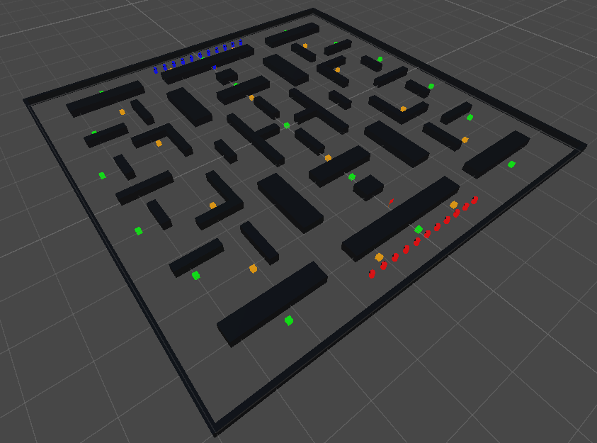

# Capture the Flag

This exercise pits two teams of [troopers](#trooper "Trooper") against each other in a game of capture the flag.

## Trooper Controller

The [`TrooperController` component](api/KaijuSolutions.Agents.Exercises.CTF.TrooperController.md "TrooperController") is provided to be a starting point for you to implement your behaviour design in for the [troopers](#trooper "Trooper").

## Trooper

The [`Trooper` component](api/KaijuSolutions.Agents.Exercises.CTF.Trooper.md "Trooper") has a given health value that if it reaches `0` will cause the [trooper](api/KaijuSolutions.Agents.Exercises.CTF.Trooper.md "Trooper") to be eliminated, respawning after a certain amount of time. Then are armed with a [blaster actuator](#blaster-actuator "Blaster Actuator"). [Troopers](api/KaijuSolutions.Agents.Exercises.CTF.Trooper.md "Trooper") will automatically interact with [pickups](#pickups "Pickups") they walk into. 

## Sensors

Six [sensors](sensors.md "Sensors") have been provided to help you with your development. Unlike the [microbes exercise](microbes.md "Microbe"), these [sensors](sensors.md "Sensors") are not yet attached to the [troopers](#trooper "Trooper") prefab, and instead this is left for you to decide which combination is best to complete the exercise.

### Trooper Vision Sensor

The [`TrooperVisionSensor`](api/KaijuSolutions.Agents.Exercises.CTF.TrooperVisionSensor.md "TrooperVisionSensor") allows for detecting other [troopers](#trooper "Trooper").

#### Trooper Enemy Vision Sensor

The [`TrooperEnemyVisionSensor`](api/KaijuSolutions.Agents.Exercises.CTF.TrooperEnemyVisionSensor.md "TrooperEnemyVisionSensor") is a version of the [`TrooperVisionSensor`](api/KaijuSolutions.Agents.Exercises.CTF.TrooperVisionSensor.md "TrooperVisionSensor") which detects [troopers](#trooper "Trooper") on the enemy team.

#### Trooper Team Vision Sensor

The [`TrooperTeamVisionSensor`](api/KaijuSolutions.Agents.Exercises.CTF.TrooperTeamVisionSensor.md "TrooperTeamVisionSensor") is a version of the [`TrooperVisionSensor`](api/KaijuSolutions.Agents.Exercises.CTF.TrooperVisionSensor.md "TrooperVisionSensor") which detects [troopers](#trooper "Trooper") on the same team.

### Ammo Vision Sensor

The [`AmmoVisionSensor`](api/KaijuSolutions.Agents.Exercises.CTF.AmmoVisionSensor.md "AmmoVisionSensor") allows for detecting all [ammo pickups](#ammo-pickup "Ammo Pickup").

### Health Vision Sensor

The [`HealthVisionSensor`](api/KaijuSolutions.Agents.Exercises.CTF.HealthVisionSensor.md "HealthVisionSensor") allows for detecting all [health pickups](#health-pickup "Health Pickup").

### Flag Vision Sensor

The [`FlagVisionSensor`](api/KaijuSolutions.Agents.Exercises.CTF.FlagVisionSensor.md "FlagVisionSensor") allows for detecting both [flag](#flag "Flag") in the game.

## Blaster Actuator

The [`BlasterActuator`](api/KaijuSolutions.Agents.Exercises.CTF.BlasterActuator.md "BlasterActuator") is an version of an [attack actuator](actuators.md#attack-actuator "BlasterActuator") which is capable of reducing the health of [troopers](#trooper "Trooper"). The [blaster](api/KaijuSolutions.Agents.Exercises.CTF.BlasterActuator.md "BlasterActuator") requires ammo, and with no ammo, the [blaster](api/KaijuSolutions.Agents.Exercises.CTF.BlasterActuator.md "BlasterActuator") will fail to attack. For your convenience, a [`BlasterActuator`](api/KaijuSolutions.Agents.Exercises.CTF.BlasterActuator.md "BlasterActuator") has been attached to the [trooper](#trooper "Trooper") prefab.

## Pickups

[Troopers](#trooper "Trooper") will automatically interact with pickups they walk into.

### Ammo Pickup

[`AmmoPickup`](api/KaijuSolutions.Agents.Exercises.CTF.AmmoPickup.md "AmmoPickup") instances will restore a [trooper's](#trooper "Trooper") [blater actuator's](#blaster-actuator "Blaster Actuator") ammo. After being used by a [trooper](#trooper "Trooper"), the [ammo pickup](api/KaijuSolutions.Agents.Exercises.CTF.AmmoPickup.md "AmmoPickup") will go on cooldown before it can be used again.

### Health Pickup

[`HealthPickup`](api/KaijuSolutions.Agents.Exercises.CTF.HealthPickup.md "HealthPickup") instances will restore a [trooper's](#trooper "Trooper") health. After being used by a [trooper](#trooper "Trooper"), the [health pickup](api/KaijuSolutions.Agents.Exercises.CTF.HealthPickup.md "HealthPickup") will go on cooldown before it can be used again.

### Flag

There are two [`Flag`](api/KaijuSolutions.Agents.Exercises.CTF.Flag.md "Flag") instances in the game, one for each team. [Troopers](#trooper "Trooper") interact with the [flags](api/KaijuSolutions.Agents.Exercises.CTF.Flag.md "Flag") in the following ways:

1. The [flag](api/KaijuSolutions.Agents.Exercises.CTF.Flag.md "Flag") is for the [trooper's](#trooper "Trooper") team:
   1. If the [flag](api/KaijuSolutions.Agents.Exercises.CTF.Flag.md "Flag") is already at its base, being where it starts the game at, nothing happens.
   2. Anywhere else, making contact with the [flag](api/KaijuSolutions.Agents.Exercises.CTF.Flag.md "Flag") when it is on the ground will return it to the base.
1. The [flag](api/KaijuSolutions.Agents.Exercises.CTF.Flag.md "Flag") is for the enemy team:
   1. The [flag](api/KaijuSolutions.Agents.Exercises.CTF.Flag.md "Flag") will be picked up. If returend to the [trooper's](#trooper "Trooper") base, being the spawn position of their team's [flag](api/KaijuSolutions.Agents.Exercises.CTF.Flag.md "Flag"), the enemy [flag](api/KaijuSolutions.Agents.Exercises.CTF.Flag.md "Flag") will be captured. Once captured, a [flag](api/KaijuSolutions.Agents.Exercises.CTF.Flag.md "Flag") will return back to its base. If eliminated while carrying a [flag](api/KaijuSolutions.Agents.Exercises.CTF.Flag.md "Flag"), the [flag](api/KaijuSolutions.Agents.Exercises.CTF.Flag.md "Flag") will be dropped for other [troopers](#trooper "Trooper") to interact with.

## Spawn Point

The [`SpawnPoint` components](api/KaijuSolutions.Agents.Exercises.CTF.SpawnPoint.md "SpawnPoint") indicate where [troopers](#trooper "Trooper") can spawn. Spawns are chosen by positions that are open first, and then those which are closest to the center of the level.

## Capture the Flag Manager

The [`CaptureTheFlagManager`](api/KaijuSolutions.Agents.Exercises.CTF.CaptureTheFlagManager.md "CaptureTheFlagManager") handles the configuration for the exercise.