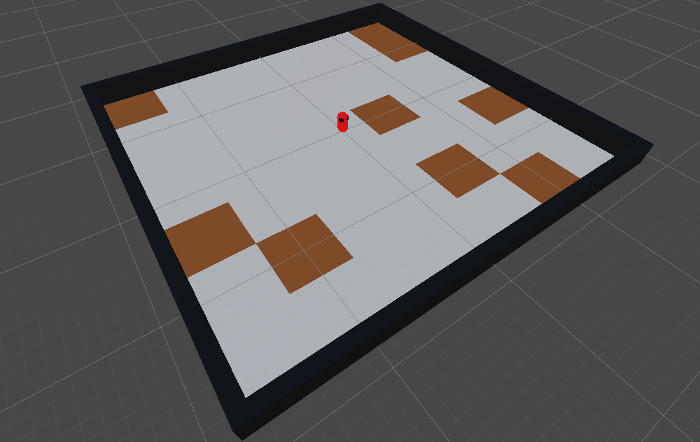

# Cleaner

In this exercise, you will need to make an [agent](agents.md "Agents") with any needed [sensors](sensors.md "Sensors") or [actuators](actuators.md "Actuators") to keep a set of [floor tiles](#floor "Floor") clean. To do this, it is recommended you make and attach a [controller](controllers.md "Controller") to your [agent](agents.md "Agents").

## Floor

A [`Floor` component](api/KaijuSolutions.Agents.Exercises.Cleaner.Floor.md "Floor") is attached to every floor tile in the scene. Given a chance value, every step a tile may randomly become dirty. You should design a [sensor](sensors.md "Sensors") designed to detect dirty [floor tiles](api/KaijuSolutions.Agents.Exercises.Cleaner.Floor.md "Floor"), and an [actuator](actuators.md "Actuators") to clean them.