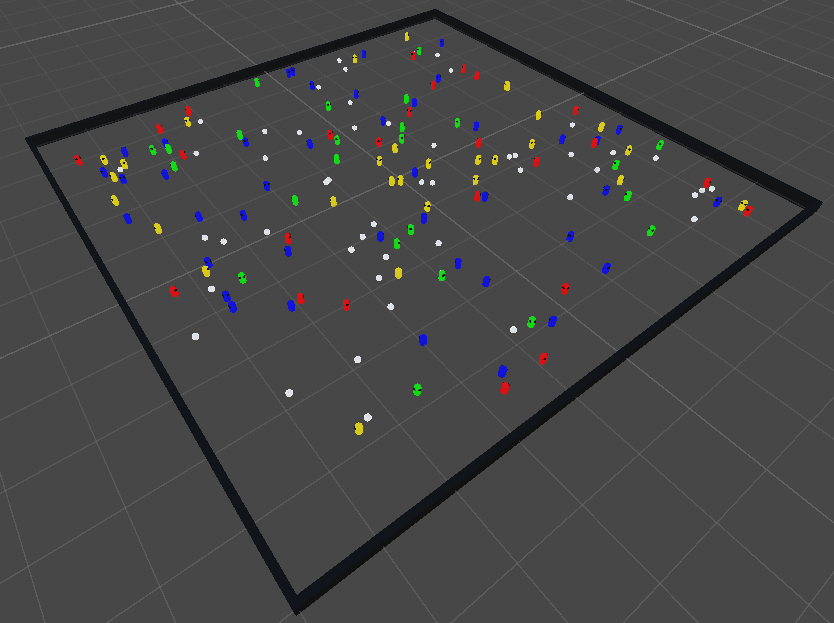

# Microbes

This exercise puts you in charge of designing [microbes](#microbe "Microbe") which can mate with and eat each other.

## Microbe Controller

The [`MicrobeController` component](api/KaijuSolutions.Agents.Exercises.Microbes.MicrobeController.md "MicrobeController") is provided to be a starting point for you to implement your behaviour design in for the [microbes](#microbe "Microbe").

## Microbe

The [`Microbe` component](api/KaijuSolutions.Agents.Exercises.Microbes.Microbe.md "Microbe") contains all aspects of the [microbes](api/KaijuSolutions.Agents.Exercises.Microbes.Microbe.md "Microbe") for this exercise. [Microbes](api/KaijuSolutions.Agents.Exercises.Microbes.Microbe.md "Microbe") require energy to survive, and it will decay at a given rate over time. Once a [microbe](api/KaijuSolutions.Agents.Exercises.Microbes.Microbe.md "Microbe") hits `0` energy, it will be despawned. Each [microbe](api/KaijuSolutions.Agents.Exercises.Microbes.Microbe.md "Microbe") has a unique [identifier](agents.md#identifiers "Identifiers") corresponding to their color. [Microbes](api/KaijuSolutions.Agents.Exercises.Microbes.Microbe.md "Microbe") can mate with other [microbes](api/KaijuSolutions.Agents.Exercises.Microbes.Microbe.md "Microbe") that have the same [identifier](agents.md#identifiers "Identifiers") as them, and can eat [microbes](api/KaijuSolutions.Agents.Exercises.Microbes.Microbe.md "Microbe") with different identifiers. Mating has a cooldown timer, and eating another [microbe](api/KaijuSolutions.Agents.Exercises.Microbes.Microbe.md "Microbe") requires having more energy than the other [microbes](api/KaijuSolutions.Agents.Exercises.Microbes.Microbe.md "Microbe"). Eating another [microbe](api/KaijuSolutions.Agents.Exercises.Microbes.Microbe.md "Microbe") will add that [microbe](api/KaijuSolutions.Agents.Exercises.Microbes.Microbe.md "Microbe")'s energy to the energy of the [microbe](api/KaijuSolutions.Agents.Exercises.Microbes.Microbe.md "Microbe") which ate it. A newly spawned [microbe](api/KaijuSolutions.Agents.Exercises.Microbes.Microbe.md "Microbe") as a result of mating will have an energy level equal to the average of its two parents. Mating and eating are both automatically handled when microbes collide with each other.

## Energy Pickup

[`EnergyPickup`](api/KaijuSolutions.Agents.Exercises.Microbes.EnergyPickup.md "EnergyPickup") instances randomly spawn around the level, and when a [microbe](#microbe "Microbe") makes contact with one it will add a given energy level to the [microbe](#microbe "Microbe"). After being used by a [microbe](#microbe "Microbe"), the [energy pickup](api/KaijuSolutions.Agents.Exercises.Microbes.EnergyPickup.md "EnergyPickup") will despawn.

## Sensors

Two [sensors](sensors.md "Sensors") have been provided to help you with your development. Each of these sensors have already been attached to the [microbe](#microbe "Microbe") prefab.

### Microbe Vision Sensor

The [`MicrobeVisionSensor`](api/KaijuSolutions.Agents.Exercises.Microbes.MicrobeVisionSensor.md "MicrobeVisionSensor") allows for detecting other [microbes](#microbe "Microbe").

### Energy Vision Sensor

The [`EnergyVisionSensor`](api/KaijuSolutions.Agents.Exercises.Microbes.EnergyVisionSensor.md "EnergyVisionSensor") allows for detecting [energy pickups](#energy-pickup "Energy Pickups").

## Microbe Manager

The [`MicrobeManager`](api/KaijuSolutions.Agents.Exercises.Microbes.MicrobeManager.md "MicrobeManager") handles the configuration for the exercise.