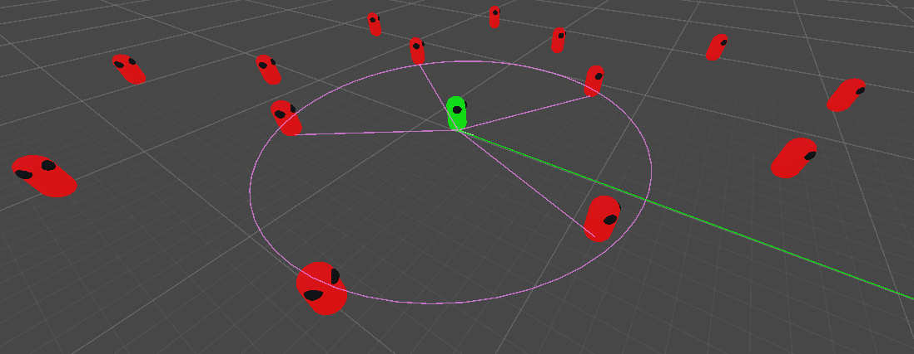

# Movement

Movements control how [agents](agents.md "Agents") move through the world. For setting movement behaviours on [agents](agents.md "Agents"), see the [movement section of the agents documentation](agents.md#movement "Agents").

## Configuration

A [`KaijuMovementConfiguration` ScriptableObject](api/KaijuSolutions.Agents.Movement.KaijuMovementConfiguration.md "KaijuMovementConfiguration") can be assigned to an [agent](agents.md "Agents") to control the default parameters of the various movement behaviours. To create a [`KaijuMovementConfiguration`](api/KaijuSolutions.Agents.Movement.KaijuMovementConfiguration.md "KaijuMovementConfiguration"), right click in the [project window](https://docs.unity3d.com/Manual/ProjectView.html "Project Window") and go to "Create > Kaiju Solutions > Agents > Kaiju Movement Configuration" and name the file. Then, assign it to your [agent](agents.md "Agents") in the [inspector](https://docs.unity3d.com/Manual/UsingTheInspector.html "Inspector Window").

## Types

The following movement types are provided with Kaiju Agents. Each has corresponding methods on [agent](agents.md "Agents") to perform the given movement.

### Seek

Move directly towards a target. It is the inverse of [flee](#flee "Flee").

### Pursue

Moves towards a target's calculated future position based on extrapolating where it will be in the future given its current and past position. The movement towards this calculated future position is the same as a [seek](#seek "Seek") movement. It is the inverse of [evade](#evade "Evade").

### Flee

Move directly away from a target. It is the inverse of [seek](#seek "Seek").

### Evade

Moves away from a target's calculated future position based on extrapolating where it will be in the future given its current and past position. The movement away from this calculated future position is the same as a [flee](#flee "Flee") movement. It is the inverse of [pursue](#pursue "Pursue").

### Wander

This will randomly move the agent based on choosing a random point along a circle's circumference which is projected a given distance ahead of it. This movement towards the random point is the same as [seek](#seek "Seek").

### Separation

Separation aims to maintain a radius of space from other [agents](agents.md "Agents"). A position based on all other [agents](agents.md "Agents") currently currently within its separation radius is calculated at which point a weighted [seek](#seek "Seek") is performed to reach it.

### Obstacle Avoidance

Obstacle avoidance casts rays to detect obstacles. If one is detected, the normal of the closest ray is used to calculate a point away from the obstacle for the [agent](agents.md "Agents") to [seek](#seek "Seek") to.

### Path Following

Path following calculates a path towards a target and the performs subsequent [seek](#seek "Seek") movements on each point along the path. This requires navigation data to be baked in the world. To learn more, see the [Unity AI navigation documentation](https://docs.unity3d.com/Packages/com.unity.ai.navigation@latest "AI Navigation").

Path following and the `FindPath` extensions use Unity’s `NavWorld` to locate nearby endpoints on the baked surface. Two points on the same polygon can be joined directly. For longer routes Unity calculates the path corners, including turns and navigation links. Pass a `NavMeshQueryFilter` to select the baked agent type, allowed areas and traversal costs. Supplying a string-pulling radius also enables the physics line-of-sight shortcut before the mesh query.

### Walking between floors

Call `PathFollow(Vector3)` on a Kaiju Navigation Agent for a surface-constrained route. Bake connected walkable surfaces for that agent type. Connect separate floors with a NavMesh link where the agent may actually cross. The component's Surface Snap Distance limits the distance between the requested destination and the baked surface. A destination with no complete route leaves the agent waiting. Inspect `HasCompleteSurfaceRoute`, change the target or call the movement's `CalculatePath()` after changing the navigation data.

The native NavMeshAgent owns translation and link traversal while following the route. Its auto-traverse setting controls automatic link crossing. Projects with a custom traversal animation can complete the link through Unity's NavMeshAgent. Give the agent one surface route at a time. The Vector2 path-follow overload keeps planar steering and blending. The general-purpose `FindPath` extensions and Transform-agent path movements retain their direct fallback for off-mesh targets.

### Free flight

Add **Free Flight** to a GameObject with a Kaiju Transform Agent or Kaiju Rigidbody Agent. Use `agent.Seek(worldPoint)` for a destination, `agent.Pursue(target)` for a moving target, or `agent.Control3 = Vector3.up` for continuous ascent. A Vector2 seek steers horizontally at the current altitude. The XYZ speed limit also applies on diagonals. Free Flight keeps automatic facing level unless **Pitch To Velocity** is enabled. It suspends Rigidbody gravity and the vertical position constraint while active.

For a patrol, author world-space waypoints and seek the next when the previous movement finishes. Use `agent.FreeFlight.HasClearance(destination, radius, obstacles)` to test a straight segment against solid colliders. Select obstacle layers that exclude the drone itself. A Transform agent can pass through obstacles if you command it directly. For routes around obstacles, supply safe waypoints. Import **Floors and Flight** in Package Manager for the *Two Storeys* and *Open Air Patrol* scenes. Open either scene and press Play. The scene creates its demonstration geometry on startup. Select the scene root to edit the patrol waypoints.

For an entity-only flyer, use `LocalTransform` and `KaijuFlightSteering`. Set `DesiredVelocity` and `MaxSpeed` before the fixed step. Add a `KaijuFlightInput` buffer to blend world-space velocities, seek targets or flee targets. Use one steering component per entity. Planar agents continue using `KaijuSteering` and `KaijuMovementInput`.

Enable **Spatial Vision** to measure spherical distance and use a 3D view cone on vision sensors. ECS agents can use `KaijuSphericalRangeSensor` for spherical detection independently of their movement type. Existing range sensors use XZ. With ML-Agents installed, **Include Climb** appends Y after the existing X and Z velocity observations or control actions. Choose the corresponding three-channel model before starting training or inference.

## Preferences

To change the colors of movement visualizations, from the top menu, go to `Edit > Project Settings` and select `Kaiju Agents`.

For a strict route query without moving an agent, use the main-thread `TryFindSurfacePath` Vector3 extension. Supply a NavMeshQueryFilter, snap distance, reusable NavMeshPath, and caller-owned corner array by reference. The return value is true only for a complete route. Inspect the status for a partial, invalid, or unmapped result and read only the returned corner count. The general FindPath helpers retain their direct-steering fallback.
