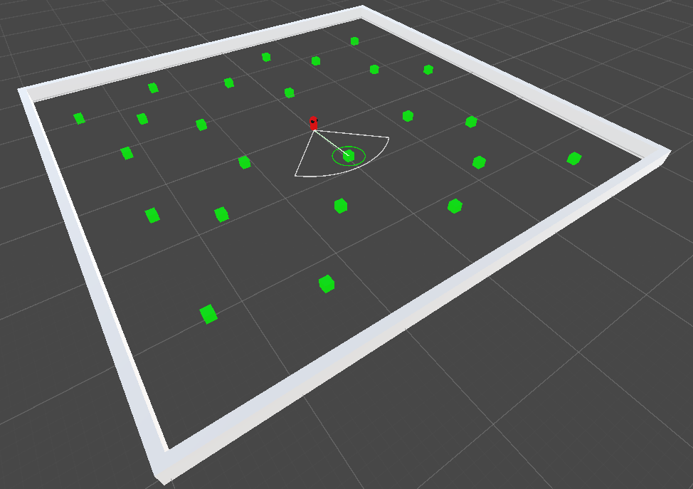

# Samples and Exercises

[Samples](#samples "Samples") provide quick learning resources for Kaiju Agents, and [exercises](#exercises "Exercises") provide an easy way to build your skills with Kaiju Agents. To access [samples](#samples "Samples") and [exercises](#exercises "Exercises"), from the top menu, go to `Window > Package Management > Package Manager`, go to the `In Project` tab, select `Kaiju Agents`, and click on `Samples`. From there, click the `Import` button next to the [sample](#sample "Samples") or [exercise](#exercises "Exercises") you want. **Note that for all [samples](#sample "Samples") and [exercises](#exercises "Exercises"), you must first import the [`Materials` sample](#materials "Materials Sample").**

## Samples

### Materials

The `Materials` sample simply contains [materials](https://docs.unity3d.com/Manual/class-Material.html "Materials") used throughout the other samples and [exercises](#exercises "Exercises"). If materials appear pink, from the top menu, go to `Window > Rendering > Render Pipeline Converter`, choose `Built-in to URP` or `Built-in to HDRP`, select all materials, click `Initialize Converters`, and lastly click `Convert Assets`.

### Movement

This sample provides multiple scenes to demonstrate [movements](movement.md "Movement"). There are scenes for:

- Comparing [seek](movement.md#seek "Seek") and [pursue](movement.md#pursue "Pursue").
- Comparing [flee](movement.md#flee "Flee") and [evade](movement.md#evade "Evade").
- Demonstrating [wandering](movement.md#wander "Wander").
- Demonstrating [sepration](movement.md#sepration "Separation").
- Demonstrating [obstacle avoidance](movement.md#obstacle-avoidance "Obstacle Avoidance").
- Demonstrating [path following](movement.md#path-following "Path Following").

### Keyboard

This sample provides a scene with an agent that can be controlled with a keyboard. To control the agent, use WASD or the arrow keys to move, and Q and E to turn. Hold space to make the agent move relative to its current heading.

### Box Destroyer

This provides a sample scene of an agent which is tasked with destroying "boxes". The agent demonstrates the use of an [everything vision sensor](sensors.md#everything-vision-sensor "Everything Vision Sensor") and an [everything attack actuator](actuators.md#everything-attack-actuator "Everything Attack Actuator") being controlled by a [controller](controllers.md "Controllers").

## Exercises

Several exercises tailored to help you learn Kaiju Agents or use in an education environment are provided. Each exercise is more complicated than the last, providing an efficient learning experience for Kaiju Agents.

1. [Cleaner](cleaner.md "Cleaner")
2. [Microbes](microbes.md "Microbes")
3. [Capture the Flag](capture-the-flag.md "Capture the Flag")
## Visual Decisions

Open Rescue Decisions and inspect the agent as its state machine calls planners, a Utility selector and a behavior tree. With ML-Agents installed the sample executes its identity policy and then a C# pickup action. Without the optional package a C# provider demonstrates the same handoff. [Visual decision graphs](behavior-graph.md)
