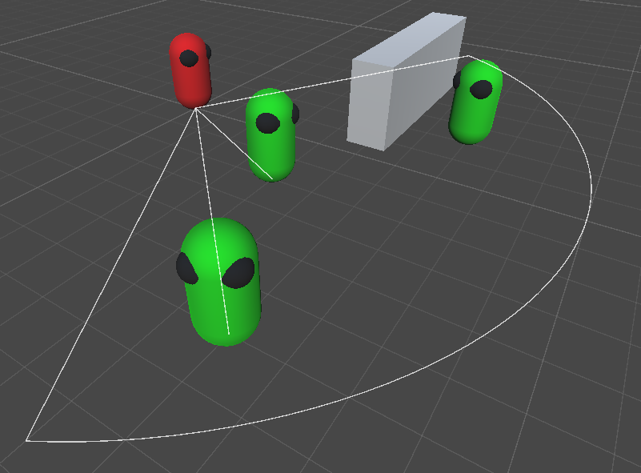
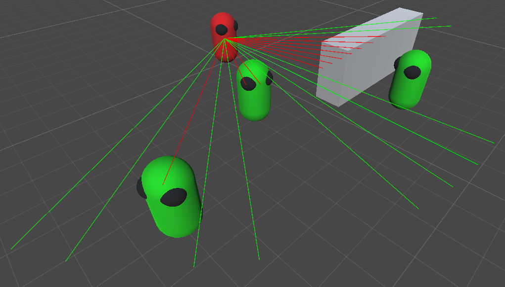

# Sensors

Sensors are all extended from the [`KaijuSensor` class](api/KaijuSolutions.Agents.Sensors.KaijuSensor.md "KaijuSensor") implementing the [`Run()` method](api/KaijuSolutions.Agents.Sensors.KaijuSensor.md#KaijuSolutions_Agents_Sensors_KaijuSensor_Run "KaijuSensor - Run"). Sensors must be directly attached to or within the child [GameObjects](https://docs.unity3d.com/Manual/class-GameObject.html "GameObject") of an [agent](agents.md "Agents"). Sensors can be run either automatically or manually executed via the [`Sense()` method](api/KaijuSolutions.Agents.Sensors.KaijuSensor.md#KaijuSolutions_Agents_Sensors_KaijuSensor_Sense "KaijuSensor - Sense").

## Vision Sensor

The [`KaijuVisionSensor`](api/KaijuSolutions.Agents.Sensors.KaijuVisionSensor-1.md "KaijuVisionSensor") is the base class for implementing vision detecting for a specific [component](https://docs.unity3d.com/Manual/Components.html "Component") type. It allows for setting a view distance, view angle, and if line-of-sight checks should be performed. If line-of-sight checks are disabled, any objects of the [component](https://docs.unity3d.com/Manual/Components.html "Component") type in the viewing area defined by the distance and angle will be detected. All detected items can be accessed via the [`Observed` property](api/KaijuSolutions.Agents.Sensors.KaijuVisionSensor-1.md#KaijuSolutions_Agents_Sensors_KaijuVisionSensor_1_Observed "KaijuVisionSensor - Observed").

### Agents Vision Sensor

The [`KaijuAgentsVisionSensor`](api/KaijuSolutions.Agents.Sensors.KaijuAgentsVisionSensor.md "KaijuAgentsVisionSensor") is an implementation of the [`KaijuVisionSensor`](api/KaijuSolutions.Agents.Sensors.KaijuVisionSensor-1.md "KaijuVisionSensor") for detecting all [agents](agents.md "Agents"). This can optionally choose to query for only specific [agents](agents.md "Agents") based on identifiers.

### Everything Vision Sensor

The [`KaijuEverythingVisionSensor`](api/KaijuSolutions.Agents.Sensors.KaijuEverythingVisionSensor.md "KaijuEverythingVisionSensor") checks for all objects in the scene. You can filter by name to get specific [transforms](https://docs.unity3d.com/Manual/class-transform.html "Transform").

## Cast Sensor

The [`KaijuCastSensor`](api/KaijuSolutions.Agents.Sensors.KaijuCastSensor.md "KaijuCastSensor") works by casting a set number of rays for a set distance evenly spread out over a set angle. What the rays hit can be accessed via the [`Hits` property](api/KaijuSolutions.Agents.Sensors.KaijuCastSensor.md#KaijuSolutions_Agents_Sensors_KaijuCastSensor_Hits "KaijuCastSensor - Hits").

### Agent vision in crowds

Default agent vision shares an XZ candidate grid during each fixed sensing pass. Exact range, cone and line-of-sight checks still apply to each candidate, including Y when spatial vision is enabled. The grid captures cell membership on first use in the pass. Turn off **Use Nearby Query** for a sensor whose callbacks teleport other agents during that pass. Explicit target lists take precedence. Manual queries outside a sensing pass use current positions.

Use `KaijuAgentsManager.FindNearby(origin, radius, list, spherical)` to fill a reusable list and `sensor.TryGetNearest(out var target)` to select the nearest observation in the sensor's distance mode. `CandidatesExamined` and `SightQueries` describe the most recent scan. Object and position sorting overloads accepting caller buffers reuse their sort storage.
